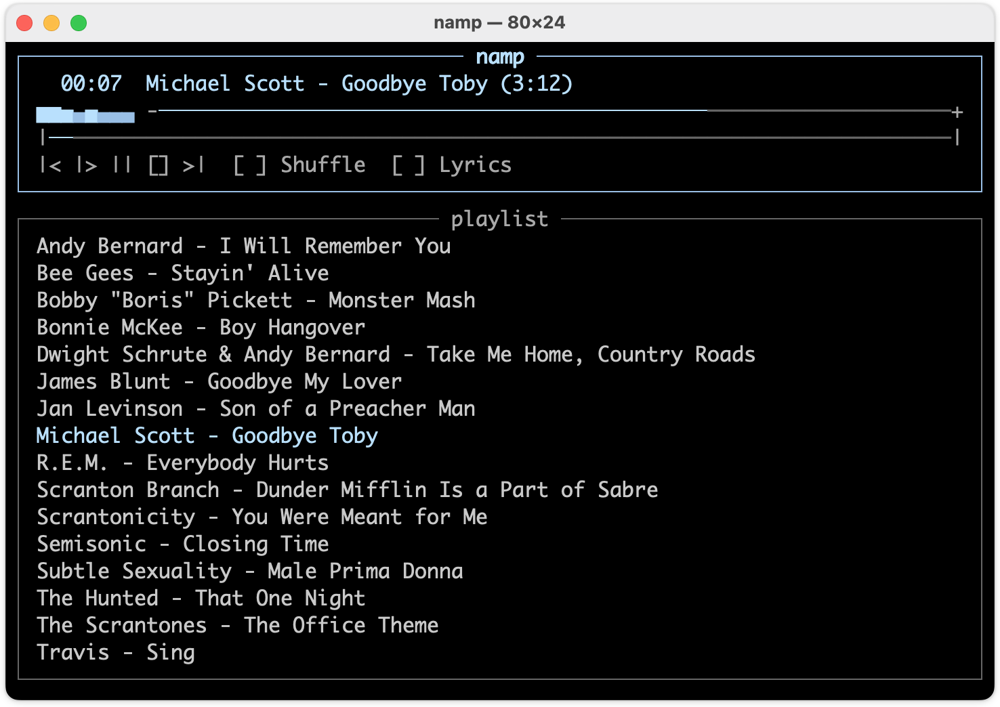

namp
====

| **Linux** | **Mac** |
|-----------|---------|
|  |  |

namp is a terminal-based MP3 player for Linux and macOS, implemented in C++ / Qt.
For systems which do not have Qt available, a lite version of namp
[namp-lite](https://github.com/d99kris/namp-lite) (Linux only) is available.

Features
--------
- Play local audio files and entire directories
- Search playlist and enqueue tracks to play next
- CD+G karaoke playback using .cdg sidecar files
- Lyrics from .lrc files, embedded tags or LRCLIB
- Real-time spectrum analyzer visualization
- Mouse control and Winamp-style key bindings
- Edit track tags using external tool idntag
- Last.fm scrobbling with status indicator
- Shuffle and sequential playback modes
- Customizable color themes

Usage
=====
Usage:

    namp OPTION
    namp PATH...

Command-line Options:

    --clear-cache     clear lyrics cache and exit
    -h, --help        display this help and exit
    -s, --setup       setup last.fm scrobbling account
    -t, --theme [TH]  install color theme, or select from list of
                      available themes if not specified
    -v, --version     output version information and exit
    PATH              file or directory to add to playlist

Command-line Examples:

    namp ~/Music      play all files in ~/Music
    namp hello.mp3    play hello.mp3
    namp -t default   install the default color theme

Interactive Commands:

    z                 previous track
    x                 play
    c                 pause
    v                 stop
    b                 next track
    q,ESC             quit
    /,j               find
    up,+              volume up
    down,-            volume down
    left              skip/fast backward
    right             skip/fast forward
    home              playlist top
    end               playlist end
    pgup              playlist previous page
    pgdn              playlist next page
    ENTER             play selected track
    TAB               toggle main window / playlist focus
    a                 toggle spectrum analyzer
    d                 toggle show folder names
    e                 enqueue selected track
    E                 unenqueue selected track
    f                 toggle fullscreen (lyrics/cdg)
    k                 toggle CDG karaoke window
    l                 toggle lyrics view
    L                 refetch lyrics (bypass cache)
    s                 toggle shuffle on/off
    t                 external tag editor
    w                 toggle lyrics window / terminal lyrics
    ,                 lyrics font smaller
    .                 lyrics font larger
    ;                 lyrics font reset

Scrobble Indicators:

    _                 now playing sent to last.fm
    ^                 scrobbled to last.fm
    ~                 not scrobbled (missing artist/title tags)
    !                 scrobbling failed

Themes
======
The colors of namp can be customized in `color.conf`, located at:

    ~/.config/nope/namp/color.conf                (Linux)
    ~/Library/Preferences/nope/namp/color.conf    (macOS)

The file is created with default values (the classic namp look using terminal
default colors) the first time namp is started.

namp comes with a set of bundled color themes, which can be installed using
`namp --theme`. Without a theme name it presents a list of available themes
to select from:

    namp --theme

A theme may also be specified directly, for example:

    namp --theme pastel-blue

Available themes:

    default
    pastel-blue

The theme is written to `color.conf`, overwriting any existing file. A running
namp instance needs to be restarted for the theme to take effect. The theme
files are available in the source package under the `themes` directory and
also listed in `themes/index.txt`.

Each UI element has three settings, `<element>_attr`, `<element>_color_bg`
and `<element>_color_fg`. Elements:

    default            base colors (no _attr)
    border             window frame
    border_focus       window frame of focused window
    title              window title
    title_focus        window title of focused window
    position           elapsed time
    track              current track title
    spectrum           spectrum analyzer bars
    spectrum_peak      spectrum analyzer bars from spectrum_peak_level
                       (falls back to spectrum)
    volume             volume bar filled part
    volume_rail        volume bar unfilled part (see bar_rail_char)
    progress           progress bar filled part
    progress_rail      progress bar unfilled part (see bar_rail_char)
    controls           playback controls, bar ends and toggle labels
    toggle             shuffle / lyrics toggle mark (falls back to controls)
    scrobble           scrobble indicator (falls back to controls)
    playlist           playlist rows
    playlist_selected  selected playlist row
    playlist_playing   currently playing row (falls back to playlist)
    queue_marker       queue position, e.g. [2] (falls back to row style)
    folder             folder separator rows
    search             search prompt
    lyrics             lyrics lines (upcoming, or all lines when not synced)
    lyrics_past        lyrics lines already passed
    lyrics_current     current lyrics line
    lyrics_status      lyrics status messages, e.g. no lyrics found

Supported attributes: `normal`, `bold`, `dim`, `reverse`, `underline`,
`standout` and `italic`, which may be combined, e.g. `bold,underline`.

Supported colors: empty (terminal default), `black`, `red`, `green`,
`yellow`, `blue`, `magenta`, `cyan`, `white`, and for terminals with more
than 8 colors also `gray` and `bright_black` ... `bright_white`, as well as
color numbers, e.g. `153` (xterm 256-color palette).

Additional appearance settings:

    border_style         square or rounded window corners
    bar_fill_char        character for filled part of bars (empty for line)
    bar_rail_char        character for unfilled part of bars (empty for none)
    folder_sep_char      character for folder separator rows
    spectrum_chars       characters for spectrum bar levels 1-7 (default
                         ▁▂▃▄▅▆▇), e.g. .:-=+*# for plain ASCII, an 8th leading
                         character sets level 0 (default blank)
    spectrum_peak_level  bar level 1-7 from which spectrum_peak is used
                         (default 5), or 8 to disable

The character settings (`bar_fill_char`, `bar_rail_char`, `folder_sep_char`
and `spectrum_chars`) only support single-width characters, i.e. not
double-width characters such as CJK or emoji.

Supported Platforms
===================
namp is primarily developed and tested on macOS, but basic functionality should
work on Linux as well. Current version has been tested on:

- macOS Sequoia 15.4
- Ubuntu 24.04 LTS

Linux
=====

**Dependencies Ubuntu 20.04**

    sudo apt install libncursesw5-dev libtag1-dev cmake qtmultimedia5-dev libqt5multimedia5-plugins ubuntu-restricted-extras

**Dependencies Ubuntu 22.04 onwards**

    sudo apt install cmake libncursesw5-dev libtag1-dev qt6-base-dev qt6-multimedia-dev gstreamer1.0-pulseaudio ubuntu-restricted-extras

**Source**

    git clone https://github.com/d99kris/namp && cd namp

**Build**

    mkdir -p build && cd build && cmake .. && make -s

**Install**

    sudo make -s install

macOS
=====

**Dependencies**

    brew install cmake ncurses taglib gnu-sed
    brew install qt

**Source**

    git clone https://github.com/d99kris/namp && cd namp

**Build**

    mkdir -p build && cd build && cmake .. && make -s

**Install**

    make -s install

External Tools
==============
Using external tag editor requires [idntag](https://github.com/d99kris/idntag)
to be installed on the system.

License
=======
namp is distributed under GPLv2 license. See LICENSE file.

Keywords
========
command line, console-based, linux, macos, mp3 player, music player, ncurses,
terminal-based.
